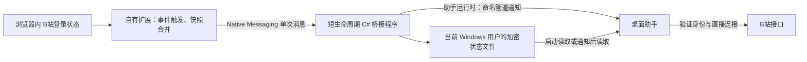

# 浏览器登录状态本机同步实施计划

日期：2026-10-14  
状态：待实施；本文件仅记录方案，不代表功能已经实现。  
适用项目：B站直播弹幕助手，Windows / WinUI 3 / C#。  
核心方向：减少登录操作，保持低 CPU、有限内存和长期稳定。

## 1. 需求与范围

用户希望直接使用浏览器已经登录的 B站账号。首次连接完成后，浏览器重新登录、切换账号或退出时，助手随之更新，不再要求手工查找和填写多个 Cookie。

本方案参考 LAPLACE Login Sync 的“通过扩展获取浏览器登录状态、自动同步变化、隐藏复杂字段”这一交互思路，独立实现本机传输。

本轮范围：

- 自有 Chrome / Edge 浏览器扩展。
- 本机 Native Messaging 桥接程序与桌面助手之间的状态传递。
- 首次绑定、手动同步、自动跟随、账号展示、断开同步及错误恢复。
- Windows 当前用户加密存储、旧配置兼容、安装与卸载。
- 有界事件处理、状态更新、连接重建与人工验收。

明确不包含：

- 接入 LAPLACE 的扩展、SDK、同步密钥、协议或服务器；不复制其实现源码。
- 云端同步、自建云服务器、跨设备共享登录状态。
- 扫码登录、用户名密码登录或自动输入浏览器账号密码。
- 直接读取 Chrome / Edge Cookie 数据库、绕过浏览器加密或安全限制。
- 向浏览器写回 Cookie、替浏览器退出账号、自动切换浏览器账号。
- 弹幕发送、送礼或其他新的账号操作权限。

用户需要在浏览器中自行完成 B站登录。同步已有凭据不能消除 B站风控、账号限制或接口自身隐藏字段的行为。

## 2. 当前实现与需要调整的地方

现有代码检查结果：

| 位置 | 当前行为 | 计划调整 |
| --- | --- | --- |
| `src/BilibiliLiveAssistant.App/MainWindow.cs` 的 `AccountPage` | 手工填写 SESSDATA、buvid3、bili_jct | 增加浏览器同步入口、账号状态和绑定管理；手工入口归入高级设置 |
| `src/BilibiliLiveAssistant.Core/LiveModels.cs` 的 `CookieOptions` / `AppSettings` | Cookie 是应用设置的一部分 | 增加凭据来源与同步配置；敏感值移入独立加密存储 |
| `src/BilibiliLiveAssistant.Infrastructure/JsonSettingsStore.cs` | 序列化完整设置到 exe 目录 | 普通设置保留原位置，保存时排除敏感登录值 |
| `src/BilibiliLiveAssistant.App/LiveAssistantViewModel.cs` | Cookie 更新可能通过 `SaveAsync` 停止并重新启动连接 | 增加专门的凭据更新通道，合并变化，保留同房间历史与监视意图 |
| `src/BilibiliLiveAssistant.App/App.xaml.cs` | 启动时读取设置并构造服务 | 加载加密凭据、启动本机通知接收、退出时取消等待 |

实施前重新核对这些位置及实际工作区状态，以当时的代码为准。不顺带重构媒体预览、弹幕渲染或概览布局。

## 3. 用户操作流程

### 3.1 首次使用

1. 用户在助手“账号设置”点击“连接浏览器”。
2. 选择 Chrome 或 Edge，查看简短说明：“使用当前浏览器的 B站登录状态，仅同步到这台电脑。”
3. 用户点击“安装本机连接组件”，注册当前 Windows 用户的桥接程序；该按钮才执行安装修改。
4. 用户通过对应入口安装自有扩展；开发验收阶段可提供加载解压扩展的步骤。
5. 浏览器已经登录 B站时，用户在扩展点击“连接直播助手”。
6. 助手显示来源名称，用户确认绑定这一浏览器配置；此时尚未接收 Cookie。
7. 扩展完成配对后发送一次完整登录快照，助手验证身份。
8. 软件显示头像、昵称及“已连接浏览器”，默认开启跟随同步。

不要求用户复制凭据或填写同步密钥。浏览器尚未登录时，显示“请在此浏览器登录 B站”，提供用户点击打开 B站的入口。

### 3.2 后续日常使用

- 浏览器登录状态变化：扩展合并变化后同步最新快照。
- 同一账号 Cookie 刷新：更新凭据；真正影响连接的字段变化才安排一次重连。
- 浏览器切换账号：验证新身份后切换助手使用的账号，并明确提示昵称变化。
- 浏览器退出 B站：助手清除该同步来源的旧账号凭据；监视期间默认继续匿名读取，明确显示原因。
- 浏览器关闭：不把“来源暂不可用”当成“账号退出”；可继续使用本地仍有效的凭据。
- 助手关闭：桥接程序保存最近状态后退出，不打开主窗口、不启动监视。
- 助手重新启动：读取本机最近快照；是否开启直播间监视仍由现有用户操作决定。
- 用户点击“立即同步”：重新读取当前浏览器状态，即使内容未变化也返回明确结果。

### 3.3 断开与重新绑定

- “断开同步”撤销当前来源绑定、清除其本地登录凭据，并拒绝后续旧配对消息。
- 断开不影响浏览器本身的 B站登录。
- 用户再次连接时重新完成配对；禁止旧扩展令牌在断开后自动恢复绑定。
- 更换浏览器来源需要明确操作；不按最后收到的一条消息自动切换来源。

## 4. 产品界面

账号页使用一张紧凑账号卡和必要操作，不在主要流程暴露 Cookie 字段。

账号卡内容：

- 当前头像、昵称；未登录时使用占位图与清晰状态。
- 来源：例如“Edge · 个人配置”。配置名称由用户命名，不读取浏览器磁盘配置目录。
- 状态：未连接、等待浏览器登录、同步中、已登录、来源暂不可用、登录已失效、连接组件需修复。
- 最近同步时间与“自动跟随浏览器”的状态。
- “在浏览器同步”“更换来源”“断开同步”操作；自动跟随开关放在扩展弹窗，账号页提供打开操作指引。

安装向导收在“连接浏览器”中；手工 Cookie 导入保留在“高级设置”中。错误使用操作型文案，例如“请在扩展中点击立即同步”，不要求普通用户理解 Native Messaging、注册表或 DPAPI。

概览读取模式菜单显示实际运行身份，例如“账号读取 · 某某”“匿名读取 · 浏览器已退出”。浏览器同步配置、凭据是否有效、当前读取模式分别记录，不能只用一个“已登录”开关混合表达。

## 5. 推荐架构

架构取舍：

- 扩展使用 Manifest V3，状态变化由浏览器事件唤醒。
- 正常同步使用 `runtime.sendNativeMessage`，每次调用启动短生命周期桥接进程，处理结束退出。
- 不建立长期 `connectNative` 连接，不用它保活扩展后台。
- 桥接程序不包含 WinUI、音频模块或弹幕渲染器，不运行 JavaScript / Node 服务。
- 桥接程序只处理配对、状态存储和本机通知，不请求 B站身份接口。
- 助手运行期间保留一个异步命名管道接收端，等待时阻塞在操作系统 I/O，不定时扫描文件。
- 本机不启用 HTTP 服务，不监听 TCP 端口，也不注册系统常驻服务。

Native Messaging 注册是浏览器与本机通信所需的安装步骤，不是安装扩展后自动获得的能力。完整功能不能仅靠一个扩展 ZIP 实现。

## 6. 扩展行为与多来源规则

### 6.1 权限和读取范围

初始权限为 `cookies`、`nativeMessaging`、`storage`、`alarms`，站点权限限定 B站所需 HTTPS 域名。实现时核对实际 Cookie 域及接口需要的最小站点集合，不申请所有网站权限。

- 初始仅支持普通浏览器配置；不支持无痕 Cookie Store、容器或跨配置读取。
- 不注入页面脚本，不依赖网页的 `document.cookie`，不读取密码、浏览记录或其他站点数据。
- 仅筛选 `SESSDATA`、`bili_jct`、`buvid3`；需要其他字段时必须先说明具体用途。
- 同名 Cookie 按目标 HTTPS URL、域、路径和 Store 选择，不能简单使用枚举中的最后一项。
- 只传递对目标 API / 直播连接实际适用的非分区 Cookie；冲突或权限不足时显示错误，不猜测来源。
- Cookie 内容只在读取、传输的短暂内存中存在，不存到扩展的 `storage.local` / `storage.sync`。

### 6.2 事件合并与后台休眠

监听所需 Cookie 的 `onChanged`。更新通常会产生删除和添加两个事件，不能见到删除事件就立刻认定退出。

建议初始参数：

| 项目 | 初始值 / 行为 |
| --- | --- |
| 短暂合并等待 | 最后一次相关事件后 2 秒 |
| 连续变化的目标最大等待 | 后台仍存活时 10 秒 |
| 自动同步限频 | 每个来源最多每 5 秒一次 |
| 待同步内容 | 只保留一个 dirty 标记；发送前重新读取完整快照 |
| 同时发送 | 每个来源 1 次，期间新的变化合并为下一份最新快照 |
| 未变化快照 | 跳过写盘、验证及重连；手动同步返回“状态未变化” |
| 失败重试 | 仅一个重试任务；约 30 秒、2 分钟、10 分钟，连续失败后停止自动重试并提示 |

短计时器不保证在 Manifest V3 后台休眠后继续执行。需保存不含 Cookie 的 dirty / revision 状态，并使用符合浏览器最小间隔的一次性 alarm 兜底；扩展启动、弹窗打开或下一次 Cookie 事件时重新检查待同步状态。

Chrome 当前文档的 alarm 最小间隔为 30 秒，实际触发还可能延迟。不得承诺所有场景都在 2 秒内同步，也不得以永久运行后台来换取这一承诺。没有变化或失败任务时，不创建周期 alarm。

完整读取后缺少 SESSDATA，才产生未登录快照；API 读取失败与缺权限产生错误状态，不产生退出快照。

### 6.3 多浏览器 / 多配置

- 首版同一 Windows 用户只绑定一个活动来源。
- 每个扩展配置生成独立随机 `sourceId`，保存在该配置的 `storage.local`，不跨设备同步。
- Chrome / Edge 及不同浏览器配置的消息必须独立标识；显示名称只用于界面，不作为权限判断依据。
- 当前绑定之外的来源不能覆盖账号，也不能清除当前来源凭据。
- 切换来源先撤销旧绑定，再配对新来源；浏览器切换 B站账号属于同一来源内部的状态变化。
- 扩展重装产生新来源，需要重新配对，不能凭旧昵称自动恢复。

### 6.4 桌面操作与扩展唤醒的边界

单次 Native Messaging 由扩展发起。桌面助手不能通过这个通道随时主动唤醒一个已经休眠的扩展后台，因此不能把桌面按钮描述为能够立即读取最新浏览器 Cookie。

- “立即同步”按钮放在扩展弹窗中，点击即读取并发送快照。
- 桌面“在浏览器同步”显示当前来源和扩展操作指引；只重新读取本机已保存状态时，按钮命名为“刷新本机状态”，不混称浏览器同步。
- 自动跟随开关由扩展控制，变化通过 `sync.configure` 通知本机并返回确认；通知失败时扩展标为待确认，桌面不能提前显示已生效。
- 桌面“断开同步”立即撤销本机绑定，独立于扩展是否已经收到这一状态。
- 不为了桌面主动按钮新增持续反向连接、HTTP 轮询或浏览器后台保活；将来需要此能力时单独评估。

## 7. 本机协议与一致性

### 7.1 配对

扩展必须具有固定、可验证的发布 ID；Native Host 的 `allowed_origins` 仅列出自有扩展 ID，不使用通配符。Chrome / Edge 商店 ID 不同则分别登记。

首次 `pair.begin` 仅提交来源元数据和随机请求标识，不传 Cookie。助手确认后，`pair.complete` 获取高熵配对令牌；令牌仅用于本机绑定，不用于 B站或外部服务。

- 首次配对要求助手正在运行且用户主动打开连接流程。
- 待确认来源最多 4 个，每项最多存活 2 分钟。
- 桥接验证调用 origin、协议版本、配对令牌和绑定代次。
- 配对令牌在扩展本地存储；桌面侧加密存储；断开后立即失效。
- origin 参数和用户级权限不等于能够抵御同一 Windows 用户权限下的恶意进程，不作绝对安全承诺。

### 7.2 消息

建议消息类型：

| 类型 | 用途 |
| --- | --- |
| `pair.begin` / `pair.complete` | 建立绑定，仅配对完成后允许发送凭据 |
| `session.snapshot` | 提交登录或明确未登录的完整快照 |
| `sync.status` | 查询绑定与最近接受状态，不返回 Cookie |
| `sync.configure` | 提交扩展侧自动跟随开关；有版本和来源校验 |
| `sync.disconnect` | 撤销发起者自己的有效绑定 |

快照包含：`protocolVersion`、`requestId`、`sourceId`、`bindingGeneration`、`sourceRevision`、`capturedAt`、`reason`、必要 Cookie 及其有效期。认证令牌与正文一起通过管道传递，不放入 URL、命令行或日志。

- 序号在读取快照前分配并保存；只接受当前绑定的新序号，同一请求重试幂等。
- 时间戳只供显示，不按时间戳决定新旧，避免系统时钟变化使旧登录复活。
- Cookie 全量替换，不逐字段叠加到旧账号；未登录快照写入带新版本的清除状态。
- 不支持的协议版本返回升级提示，不尝试解析为旧版。
- 状态 ACK 区分“已保存本机快照”和“桌面助手已验证登录”；保存成功不能显示成已登录。

Native Messaging 使用二进制标准输入 / 输出帧：长度前缀按官方协议，正文 UTF-8 JSON。标准输出只写协议消息，诊断不混入正文。

### 7.3 状态写入与通知

- 先校验、加密、原子替换状态文件，再发送包含版本号的命名管道通知。
- 本机状态文件作为唯一持久事实来源；管道不重复传递 Cookie。
- 桥接与助手使用同一存储库接口，写入使用当前用户范围的互斥与版本检查。
- 等待锁和管道都有超时；最多保留最新状态，不创建无界待处理队列。
- 助手未运行时仅保存状态，ACK 为“已保存，等待助手打开”。
- 助手启动时先建立接收端，再读取快照；通知合并后再次检查版本，避免启动窗口期漏掉更新。
- 助手运行却通知失败时，由扩展有界重试或用户手动同步恢复；不宣称文件写入后必然实时应用。

## 8. 桌面账号状态与连接更新

至少分开记录三组状态：

1. 绑定状态：未绑定、已绑定、来源不可达。
2. 账号状态：等待验证、已登录、明确未登录、验证暂不可用、已失效。
3. 运行模式：未监视、匿名读取、账号读取。

处理登录快照时：

1. 校验来源与版本，取消旧版本仍在执行的验证。
2. 使用候选凭据验证 B站账号身份，复用现有身份接口能力；最多 1 个验证请求。
3. 返回仍属于当前快照时才提交 UI 状态和运行凭据，忽略迟到结果。
4. `isLogin=false` 等明确未登录结果标为失效；网络错误、HTTP 403 或响应异常标为“验证暂不可用”，不能一概当作账号退出。
5. 新来源或身份不确定期间暂停使用旧来源 Cookie；监视意图保留，按匿名读取策略维持直播连接。
6. 新账号确认后提交运行身份，必要时只重建一次直播连接及关联认证请求。

连接更新规则：

- 普通设置保存、账号切换、Cookie 刷新分别处理，不让每次同步调用完整的设置保存和重新启动流程。
- 同房间自动重连保留弹幕、SC、礼物历史与本次统计；不将账号变化误判为换房。
- 刷新已启动请求的认证快照，取消使用旧凭据的请求；使用连接代次屏蔽迟到回调。
- 同一时间最多 1 个重连操作，连续变化只应用最新有效版本。
- 验证和同步不会自动开始直播监视，也不自动打开悬浮窗。
- 匿名模式下可保存已同步账号，但实际直播请求继续不携带账号 Cookie；用户明确选择账号读取后才使用。
- 浏览器已退出时默认退回匿名读取，界面明确提示。设置中可选择改为停止监视，但不能继续使用已明确退出的旧凭据。

账号切换需要保持现有匿名读取行为，不承诺账号登录能够恢复 B站未下发的身份或事件。

## 9. 存储与配置迁移

推荐位置：

- 本机桥接组件：`%LOCALAPPDATA%/BilibiliLiveAssistant/browser-sync/`。
- 账号状态：`%LOCALAPPDATA%/BilibiliLiveAssistant/auth/`。
- 普通显示、布局等设置：继续使用当前 exe 目录的 `settings.json`。

敏感状态使用 Windows DPAPI `CurrentUser` 加密，限制文件访问为当前用户与必要系统主体；临时文件同样只包含密文。解密失败时显示重新同步入口，不静默覆盖损坏数据。

新配置记录凭据来源、绑定元数据、自动跟随设置及账号丢失时的策略。昵称、UID、最后同步时间可作为非敏感元数据，但 Cookie 和配对令牌不得进入普通 JSON、错误报告、截图示例或日志。

迁移步骤：

1. 加载当前配置，识别旧手工 Cookie。
2. 新加密库为空时，将旧凭据作为“手动导入”来源写入加密库。
3. 写入及回读确认后，原子保存不含敏感值的普通设置。
4. 加密写入或配置替换失败时，保留原始文件并提示，不先删除可用凭据。
5. 已绑定的浏览器凭据优先，不能在每次启动时被旧版 JSON 再次覆盖。
6. 首次升级不自动绑定浏览器，不自动改变用户当前读取模式。

必须审查所有设置写入路径，包括启动房间、设置页保存、概览快捷保存等，防止运行时 `CookieOptions` 再次被序列化回普通文件。运行时凭据与可序列化设置需明确分离。

DPAPI 当前用户数据不能当作跨电脑可移植配置。复制软件目录或切换 Windows 用户后，应重新绑定；普通字体、布局、DPI、礼物合并和媒体设置仍可继承。迁移只操作当前配置，不扫描或删除其他发布目录内的旧配置。

## 10. 资源限制与异常恢复

下列为首版建议上限，实施时作为配置或常量明确记录：

| 项目 | 上限 / 策略 |
| --- | --- |
| 当前有效同步来源 | 1 个 |
| 扩展待同步快照 | 1 个最新状态 |
| 本机同步正文 | 64 KiB，超限在分配正文缓冲区前拒绝 |
| 单个 Cookie 值 | 8 KiB；整体仍受正文上限约束 |
| 桥接单次处理 | 目标 5 秒内结束；锁和管道等待分别有明确超时 |
| 当前用户并行桥接处理 | 1 个；其余快速返回繁忙，交给扩展合并重试 |
| 身份验证请求 | 1 个，超时 10 秒，响应最多 256 KiB |
| 桌面待应用更新 | 1 个最新版本 |
| 账号验证重试 | 有界退避，或等待用户重试；无空闲固定轮询 |
| 账号头像 | 复用现有图片缓存，保留当前可见账号视图 |
| 诊断 | 仅状态码、版本和时间等脱敏信息；最多 3 份，每份 256 KiB |

异常行为：

- 连接组件不存在：扩展显示“请在助手安装本机连接组件”。
- 扩展未安装、权限被收回：助手展示操作指引，不读取其他来源补位。
- 注册路径损坏：用户点击修复后只更新自有注册项。
- 浏览器后台休眠：保留 dirty 状态，下一次事件、alarm 或手动同步补偿。
- 桥接失败：保留待同步标记，不连续创建进程。
- 账号验证断网：显示待验证状态，取消旧请求；不高频重试。
- 软件隐藏、换页：停止账号卡额外绘制；必要的账号同步仍跟随用户启用状态。
- 软件退出：关闭命名管道、取消验证及更新任务，不留下桌面常驻线程或桥接进程。
- 扩展关闭跟随：停止自动事件处理；保留手动同步按钮，桌面明确显示“自动跟随已关闭”。

不设置“必须低于某个 CPU 百分比”的未经测量承诺。验收需比较同机器、同房间、同展示配置下启用前后的实际差异。

## 11. 安装、发布和升级

### 11.1 首版支持

先支持 Windows 10/11 x64 的 Chrome 与 Edge 普通配置。Firefox、其他 Chromium 浏览器、无痕和多活动来源另行评估。

扩展使用自有名称与图标，明确说明仅同步本机 B站登录状态。开发阶段固定扩展 ID，正式商店发布前核对 Chrome / Edge 各自 ID 与对应桥接清单。

### 11.2 本机连接组件

- 使用当前用户注册范围安装，不默认请求管理员权限。
- Chrome / Edge 分别注册自有 Native Messaging Host。
- 推荐将桥接组件安装到稳定的用户目录，避免新版主程序发布到新目录后浏览器仍指向旧路径。
- 用户点击安装、修复或卸载时才修改注册表与组件目录；软件普通启动仅检测状态。
- 原子更新组件，检查正在运行的短生命周期桥接任务；繁忙时等待有界时间或让用户重试，不强制结束其他进程。
- 注册记录带安装版本与归属；卸载仅清理本项目自己的键和值，不删除父级浏览器注册目录。
- 是否清除本地登录状态在卸载界面明确提供，默认撤销绑定；浏览器站点 Cookie 始终不删除。

### 11.3 交付内容

桌面发布包、本机桥接程序与安装向导、自有扩展包、开发安装说明、卸载说明、配置迁移说明和手动验收表。

扩展商店发布不在本计划文件生成任务的范围内。正式分发前需另行完成发布账号、扩展 ID、包签名与商店说明；不能把开发模式加载步骤描述成已经完成的商店安装。

## 12. 分阶段实施与提交建议

在后续实施开始时检查主线程进度与工作区，确认没有并行改动同一模块。需要新任务分支时建议名称 `browser-login-sync`，遵守仓库分支命名约定。本次撰写计划不创建分支或提交。

| 阶段 | 工作与完成条件 | 建议提交 |
| --- | --- | --- |
| 0. 基线与细化 | 核对当前代码、稳定扩展 ID、既有配置迁移策略和验收环境；保存需要保留的基线 | `chore: 保存浏览器登录同步实施前基线` |
| 1. 账号模型和加密库 | 增加凭据来源、同步快照、状态机与 DPAPI 存储；逐项核对所有设置保存入口 | `feat: 加入本机账号凭据库与配置迁移` |
| 2. 本机桥接 | 原生消息帧、配对、版本校验、原子写入、命名管道通知、退出和错误边界 | `feat: 加入浏览器原生消息桥接与来源绑定` |
| 3. 浏览器扩展 | 最小权限、Cookie 快照、事件合并、休眠补偿、弹窗和有界重试 | `feat: 加入浏览器登录状态自动同步扩展` |
| 4. 桌面集成 | 账号卡、安装指引、立即同步、断开、身份验证、匿名降级与合并重连 | `feat: 接入本机浏览器同步账号界面与连接更新` |
| 5. 发布与收尾 | 安装修复卸载、迁移检查、版本匹配、说明文档、独立 Release 发布目录 | `build: 发布浏览器登录同步组件与使用说明` |

每阶段检查自身差异与资源边界后提交，避免把扩展、凭据迁移和界面改动全部集中到一个提交。阶段涉及同一代码区时顺序实施，不另开多个同时修改账号与 ViewModel 的工作任务。

## 13. 验证与完成标准

沿用项目此前的人工验证方式作为本计划的默认交付安排：实施者进行静态检查、Release 编译与发布文件核对，不启动软件、不运行自动测试；浏览器安装、真实登录、注册表修改和性能验证由用户手动操作。若后续需要自动化验证，应另行明确范围，不能把“写计划”当作执行授权。

静态检查重点：

- 明文 Cookie 不出现在设置序列化、日志、错误消息、命令行、标准输出诊断或扩展持久存储。
- 旧设置迁移顺序、原子写入和失败保留路径完整。
- 消息长度、序号、来源、配对代次和队列上限明确。
- 退出、断开、任务取消、旧回调迟到和通知失败有明确处理。
- 扩展没有固定高频轮询、长连接保活、广泛站点权限或外部上传。
- 本机组件路径稳定，Chrome / Edge 注册项与扩展 ID 对应，卸载范围准确。
- Release 包包含桥接所需运行时或明确其依赖，不因开发机器已安装运行时而漏交付。

用户手动验收：

| 场景 | 预期结果 |
| --- | --- |
| 浏览器已登录，首次绑定 | 无需复制 Cookie；显示经验证的真实账号 |
| 浏览器未登录 | 显示等待浏览器登录，匿名读取仍可使用 |
| 同账号更新 Cookie | 一次合并更新，避免连续断线或重复验证 |
| 浏览器从账号 A 切到 B | 只应用最新身份，旧验证结果不覆盖新账号 |
| Cookie 删除后立即重建 | 不把更新中间态直接当作最终退出 |
| 明确退出 B站 | 清除旧同步凭据，按策略匿名继续或停止监视 |
| 浏览器关闭或后台休眠 | 不误清凭据；恢复后同步最近状态 |
| 多浏览器 / 多配置登录不同账号 | 未绑定来源不能抢占、清除或覆盖账号 |
| 助手关闭后浏览器状态变化 | 保存最近快照，桥接退出，不弹出主窗口 |
| 再次启动助手 | 读取最近快照，不自动开启监视 |
| 断开后扩展继续尝试发送 | 旧令牌失效，不自动重新绑定 |
| 扩展重装、主程序移目录、组件升级 | 提示重新绑定或修复；已有普通设置保留 |
| 断网、验证 403、接口异常 | 显示暂不可验证，不误判为用户退出 |
| 明文旧配置迁移写入失败 | 原配置保留，不丢失原登录与显示设置 |
| 不同 Windows 用户或密文损坏 | 提示重新同步，不继续使用错误凭据 |
| 在真实浏览器设置或受控调试中构造大消息、重复序号 | 拒绝超限 / 过期输入，不写盘、不触发重连 |
| 闲置、反复登录退出、大量弹幕 | 无持续桥接进程、无无限重试，CPU / 内存无持续增长趋势 |

完成标准：用户能够不接触 Cookie 字段完成绑定；登录、更新、退出、断开和软件重启流程通过人工验收；不会破坏原匿名读取与弹幕展示；发布包含可安装、可修复、可卸载的本机组件与清晰说明。编译通过不能替代这些验收。

## 14. 技术依据与实施前确认

官方资料核对日期：2026-10-14。实现前再次核对版本要求和浏览器行为。

- [Chrome Native Messaging](https://developer.chrome.com/docs/extensions/develop/concepts/native-messaging)：本机宿主注册、来源限制、标准输入输出通信与单次消息启动方式。
- [Chrome Cookies API](https://developer.chrome.com/docs/extensions/reference/api/cookies)：Cookie 查询、权限、Store、域与路径语义及变化事件。
- [Chrome Alarms API](https://developer.chrome.com/docs/extensions/reference/api/alarms)：休眠后的唤醒补偿与最小间隔，不能充当秒级准时器。
- [Microsoft Edge Native Messaging](https://learn.microsoft.com/en-us/microsoft-edge/extensions/developer-guide/native-messaging)：Edge 原生通信安装与兼容要求。
- [.NET ProtectedData](https://learn.microsoft.com/en-us/dotnet/api/system.security.cryptography.protecteddata)：Windows 当前用户数据保护。
- [LAPLACE Login Sync 功能说明](https://laplace.live/login-sync)：仅作为用户交互与“跟随浏览器登录状态”的参考，不作为本方案依赖。

实施前尚需确定的交付条件：首个验收浏览器、正式扩展名称与发布 ID、是否进行商店发布、本机组件安装位置及现有配置迁移兼容要求。未确定时可先实现模型与加密库；正式跨组件配对和打包前必须固定 ID 与协议版本。
