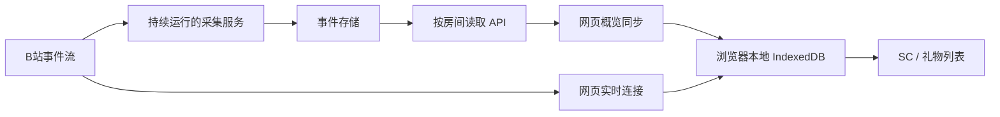

# LAPLACE 云端补录机制研究

核查日期：2026-10-18。研究对象：[21452505 房间概览](https://chat.laplace.live/dashboard/21452505)。本文区分官方文档事实、实现推论与尚未获得的运行证据。

## 为什么未开网页也能看到旧礼物

**采集发生在持续运行的服务端，网页只是之后同步结果。** 官方将这项能力称为 Event Fetcher：面板关闭时后台仍采集，默认保留最近 72 小时付费礼物，概览约每 20 分钟同步。它要求目标房间已纳入采集，不能从任意过去时段凭空补录。[Event Fetcher 官方说明](https://laplace.live/event-fetcher)

因此，用户电脑没有监视不等于所有采集者都没有监视。没有相应后台服务，也没有旧的本地记录时，单纯打开网页并不能创造历史。

## 四套容易混淆的组件

| 组件 | 保存／传输的内容 | 能否解释重开后出现旧记录 |
|---|---|---|
| Event Fetcher | 后台房间事件存储及读取 API | 可以，前提是服务早已采到该事件 |
| Chat 本地数据库 | 浏览器 IndexedDB 中的事件 | 可以，即使此次未同步到云，也能恢复同一浏览器的旧记录 |
| Login Sync | 供授权读取使用的登录状态 | 不构成礼物历史库 |
| Event Bridge | 实时事件中转 | 单独中转不等同于持久化补录 |

本地事件位于 IndexedDB，`.lca` 用于导入导出；它是浏览器本地历史，清理浏览器数据会失去这份记录，不会天然跨浏览器共享。[Archive 官方说明](https://laplace.live/chat/archives)

Login Sync 同步的是登录状态，用于读取受授权限制的直播数据。不要把“同步登录”和“同步礼物事件”视为同一功能。[Login Sync 官方说明](https://laplace.live/login-sync)

Bridge 负责广播实时事件；与 Fetcher 的 Bridge Mode 组合时，事件可以来自后台采集器，页面无需承担持续采集任务。[Event Bridge 官方说明](https://laplace.live/chat/event-bridge)

## 数据流与接口边界

图中“实时流与补录合并”是结合组件职责的架构解释，不表示已经取得闭源前端的全部去重代码。

Fetcher 文档列出了 PostgreSQL、可选 Redis、房间配置 `ROOMS`，以及 `GET /events/<room_id>`、`/info`、`/ping` 和实例 `/openapi`。读取鉴权与上传管理鉴权分开，配置器可指定自建 Cloud Event API；无需把服务理解成浏览器缓存。该服务提供容器，但文档明确说明未开源，不能宣称已审阅其数据库与去重实现。[部署、API 与环境变量](https://laplace.live/event-fetcher)

## 对“获取云端／同步数据”的准确解释

根据以上证据，这类提示很可能分别表示远端读取、与本地事件合并及更新列表。**提示文字本身不能证明每条旧消息都来自云端**：本地 IndexedDB 恢复、导入归档和云端补录都能产生旧事件。官方也明确区分启用云同步的房间与必须保持页面开启的情况。[Dashboard 官方说明](https://laplace.live/chat/dashboard)

本次能够确认机制和部署条件，不能确认以下房间实例细节：

- 21452505 当前使用哪个服务地址，采集从何时开始，是否使用默认保留期限。
- 每条 SC 的来源、云接口的 SC 事件覆盖、分页／游标和唯一 ID 语义。通用说明中的“付费礼物”不足以代替 SC 响应样本。
- 网页首次打开是否强制全量同步、具体去重键，以及请求失败重试策略。

原因：浏览器控制读取超时，Windows 浏览器检查又因无法可靠识别当前 URL 被工具中止；普通页面请求遇到 Vercel 验证页。本次没有绕过验证，也未读取用户浏览器登录凭据或向第三方上传本地记录。截图仅用作界面参考，未把截图里的历史条数当作接口证据。

若后续要验证某一条 SC，最可靠的方法是在正常可访问的页面中记录其只读网络请求：确认实际云地址、响应事件类型／ID／原时间，再与本地数据库及实时事件 ID 对照。无需清空已有浏览器数据，也无需分享登录密钥。

## 对本软件的建议（设计建议，尚未实施云同步）

本地历史继续由 SQLite 管理。若要实现“软件关闭也能补录”，必须额外选择一个持续采集来源；仅增加同步按钮不足以完成该能力。

建议先做**用户自建采集服务的只读导入**，再评估集中托管：

1. 首先用脱敏样本核实 SC、上舰、付费与免费礼物的字段、稳定事件 ID 和时间含义，明确覆盖范围。缺失稳定 ID 的来源不能靠正文猜重复。
2. 补录保存原事件时间、导入时间、来源和采集缺口；不把导入时刻算作刚发生，也不把本机已监视时长当作云端采集时长。
3. 与现有原始事件归档合并；礼物显示合并与底账去重分开，重复导入不得重复计费。默认只进入历史／概览，不把几小时前的 SC 再塞进正在直播的浮窗队列。
4. 后台串行分页、限制响应与队列、支持取消和断点续取。远端故障只影响补录，不阻塞本机实时监视。
5. 界面显示来源、覆盖时间、最后成功同步及缺口。统计区分本机与补录记录，不能宣称拿到了完整直播间历史或真实主播收入。
6. 同步地址与凭据另行设计；本轮不连接云端、不传 Cookie、不创建云账号，也不修改现有登录流程。

自建来源让采集范围和权限更明确，但需要长期运行维护。集中托管可以减少用户操作，却引入服务器成本、身份授权、保留期限及运维责任。建议在取得实际接口样本后再决定，当前不应直接复刻未知的公共云地址。
